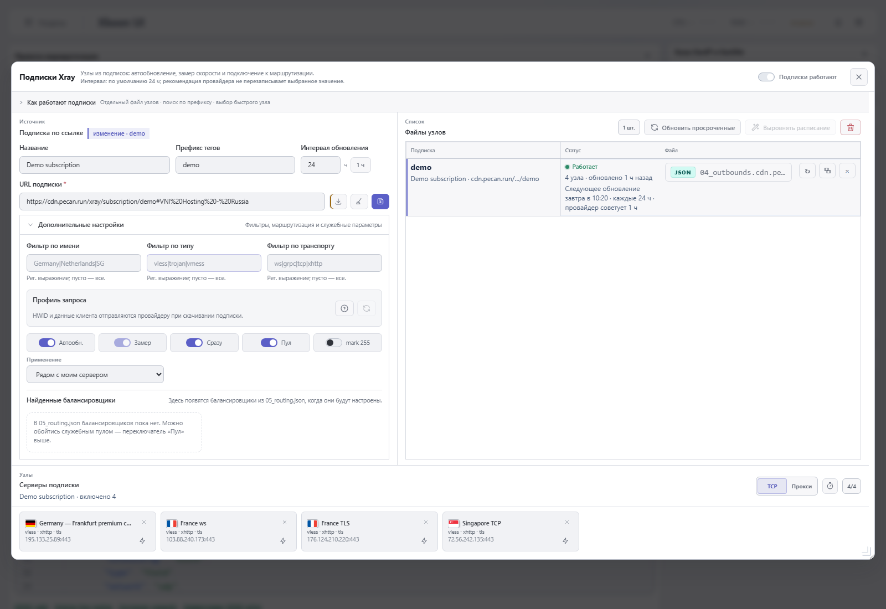
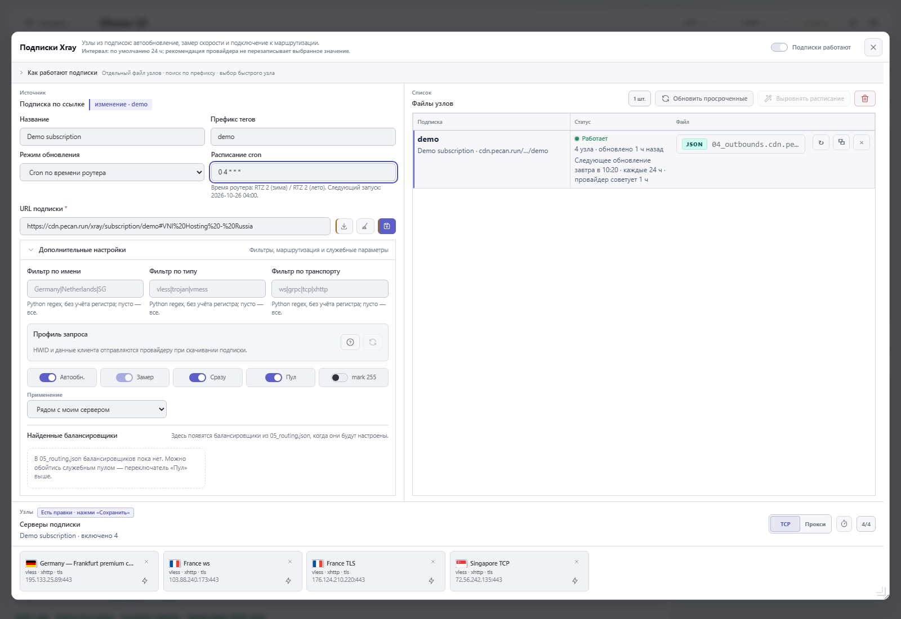
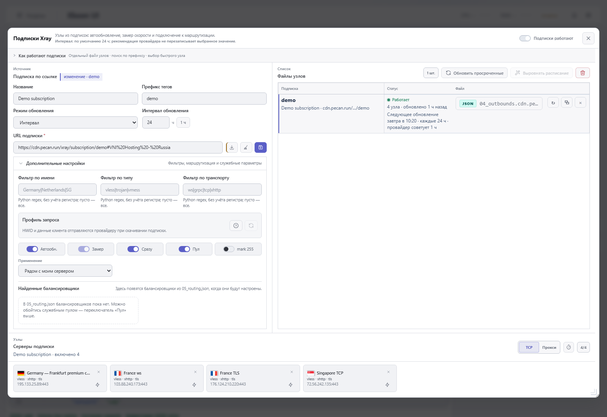
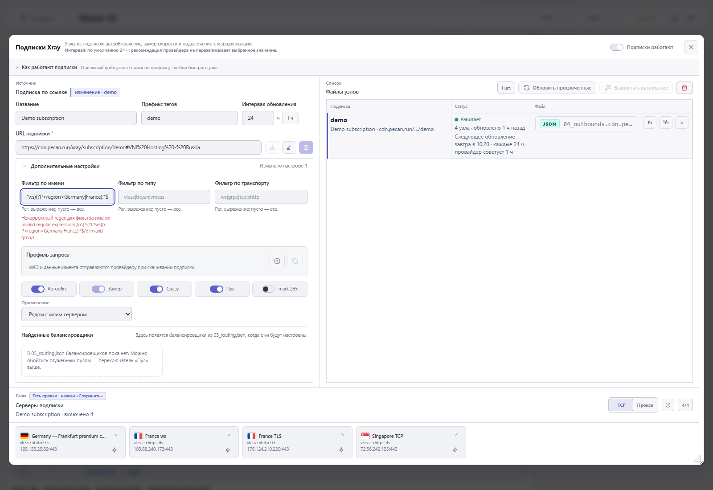
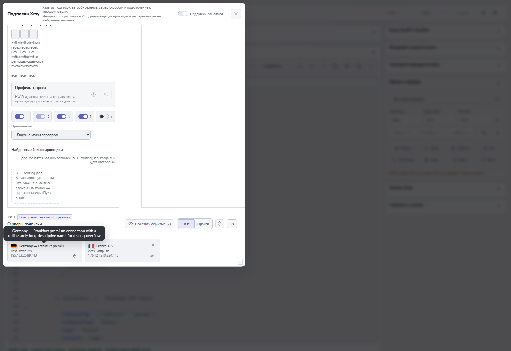
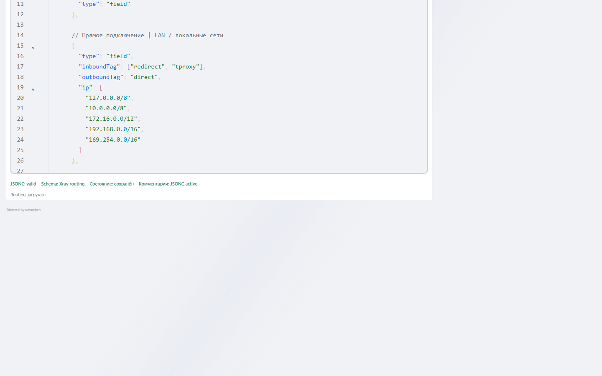
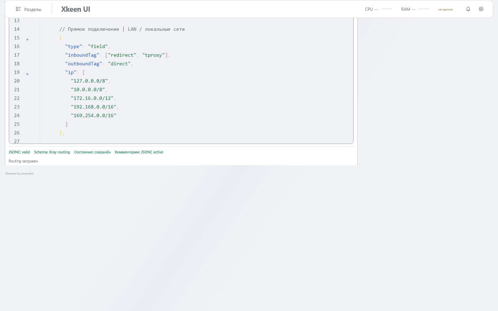

# Xray: cron-расписание, единый regex и оптимизация подписок

Доработаны подписки Xray и основная страница. Обновления можно привязать к календарному времени, предпросмотр фильтров использует тот же движок регулярных выражений, что и сервер, а повторяющиеся источники загружаются один раз за пачку.

## Изменения

- **Расписание:** отдельный выбор «Интервал / Cron» для каждой подписки. Поддерживаются пять полей, списки, диапазоны и шаги; форма показывает часовой пояс роутера, ближайший запуск и ошибки. Выбор режима и активное поле находятся рядом: при выборе cron весь блок интервала скрывается, при выборе интервала скрывается cron. Старые интервалы сохраняются. Ручное обновление не сдвигает календарные точки; cron исключён из выравнивания интервалов и раннего обновления соседних подписок.
- **Регулярные выражения:** валидация и живой предпросмотр переведены с JavaScript RegExp на Python `re`, который уже используется при сохранении и обновлении. Теперь синтаксис Python, включая встроенные флаги, именованные группы, обратные ссылки и lookaround, обрабатывается согласованно. Неверное выражение не подменяется отсутствием фильтра. Добавлены примеры в подсказках.
- **Названия подключений:** при наведении на обрезанное название карточки появляется подсказка с полным текстом. Доступен фокус с клавиатуры; проверяется фактическое обрезание.
- **Перезапуск:** сравнивается итоговая конфигурация до и после перестройки служебных файлов. Временная перезапись с возвратом прежнего содержимого не является причиной рестарта. Изменения маршрутизации, observatory и outbounds по-прежнему учитываются.
- **Одинаковые источники:** одна загрузка на URL и нормализованный профиль запроса в пределах пачки. Фильтры и итоговые списки каждой подписки остаются независимыми. Различающиеся профили запроса не объединяются; кеш не переживает пачку.
- **Загрузка интерфейса:** независимые запросы открытия окна выполняются параллельно. Внутренние копии полных конфигураций `last_generated_outbounds` исключены из компактного ответа для интерфейса, но остаются в состоянии сервера. Обычный ответ API сохраняется для совместимости; устаревшие ответы не затирают более новые.
- **Слабые устройства:** убрано создание множества исключений отдельно для каждого узла; отложен layout содержимого карточек вне экрана через `content-visibility`. Ввод фильтров обрабатывается с задержкой, устаревшие запросы отменяются, запросы черновика останавливаются при закрытии окна.
- **Основная страница:** закреплена шапка с «Разделами», логотипом и показателями ресурсов.

## Скриншоты до и после

Исходная версия — тег `v3.0.2`, commit `afefd60`. Обе версии сняты на локальных стендах с одинаковыми демонстрационными данными. Реальные ссылки и конфигурации домашнего роутера не использовались в изображениях.

### Расписание подписки

До: доступен интервал в часах. После: рядом с выбором режима показано только соответствующее поле — интервал или cron. В режиме cron блок интервала полностью скрыт; виден ближайший запуск по времени роутера.

| До | После |
| --- | --- |
|  |  |

**После — режим «Интервал».** Поле cron скрыто, ввод интервала в часах доступен.

### Регулярные выражения и полное название

Проверяемое выражение: `(?i)^(?!.*ws)(?P<region>Germany|France).*$`.
До: браузер отклоняет допустимый для Python синтаксис, карточки не соответствуют ожидаемому фильтру. После: остаются два подходящих подключения; при наведении видно полное длинное название.

| До | После |
| --- | --- |
|  |  |

### Шапка при прокрутке

Одинаковая позиция прокрутки. После изменения навигация, логотип и блок ресурсов остаются сверху.

| До | После |
| --- | --- |
|  |  |

## Измерения

Воспроизводимый сценарий: `python scripts/benchmark_xray_subscription_payload.py`. Синтетические данные, Flask test client, один прогрев и семь измерений каждого режима, без сети и провайдеров. Количество узлов указано суммарно для всех подписок.

| Подписки / узлы | Полный ответ | Компактный ответ | Сокращение | Медиана полного / компактного запроса |
| --- | ---: | ---: | ---: | ---: |
| 1 / 100 | 38 618 Б | 11 409 Б | 70,5% | 5,53 / 3,14 мс |
| 10 / 1000 | 381 941 Б | 109 851 Б | 71,2% | 33,16 / 11,66 мс |
| 50 / 5000 | 1 919 861 Б | 551 411 Б | 71,3% | 88,86 / 20,50 мс |

Это сравнение ответов локального API, а не измерение ускорения всей страницы на Keenetic. Данные и условия сохранены в `docs/subscription-improvements/benchmark.json`.

Проверка повторного обновления: два определения подписки с одинаковым источником и разными фильтрами — одна загрузка за пачку. Во второй пачке с теми же данными — ноль дополнительных рестартов. Проверено с выключенной и включённой интеграцией маршрутизации и замера задержки.

## Проверки

- 274 Python-теста проходят; два POSIX-теста переходов летнего времени пропущены на Windows. Набор включает обновление подписок, API, расписание, фильтры, маршрутизацию, откаты, паузу и инвентаризацию модулей.

- 31 браузерный тест Chromium: форма, мобильная компоновка, карточки, массовый пинг, сохранение, cron, regex, подсказка и прокрутка шапки.
- Исходная версия отдельно проверена сценариями для изображений «до».
- Сборка `frontend:build` и `verify_frontend_build.mjs` проходят.
- Проверка синтаксиса JavaScript, ошибок Python и `git diff --check` проходит.

## Совместимость и ограничения

Изменения подписок относятся к Xray. Mihomo не дорабатывался. Пять полей cron используют часовой пояс системы роутера; фактический запуск зависит от очередного тика планировщика и нагрузки. При простое выполняется один просроченный запуск; последующие сроки возвращаются к календарю. Поведение переходов летнего времени описано в `DECISIONS.md`.

Локальные проверки проведены на Windows с Python 3.12 и Chromium. Два POSIX-теста переходов летнего времени на Windows пропущены. Изменённая версия на домашний Keenetic не устанавливалась; аппаратная проверка новых функций и полный upstream CI пока не проводились.
